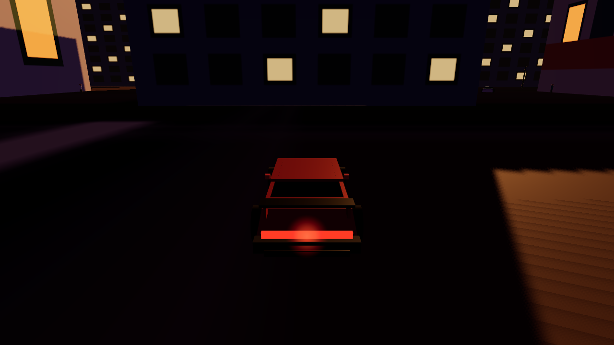
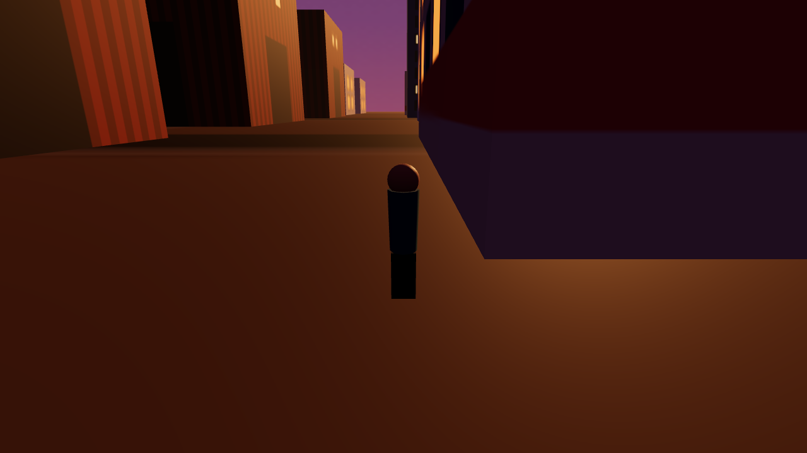
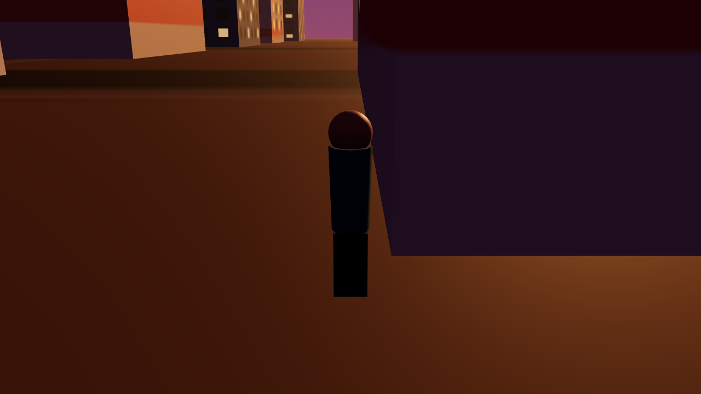
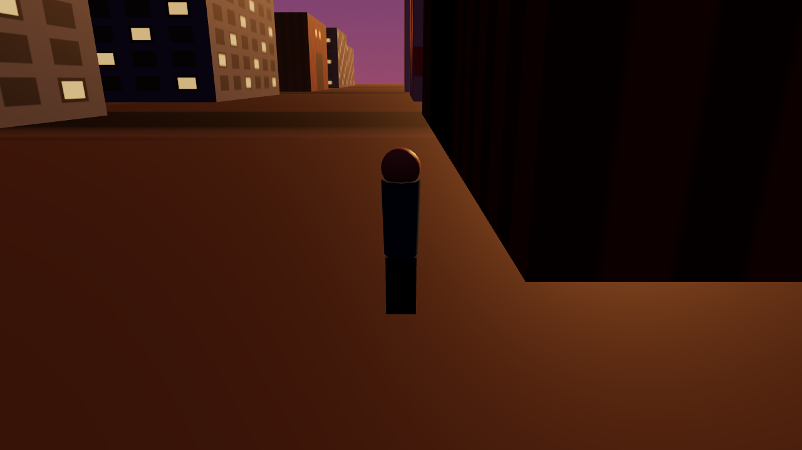

# Caldera Bay

**Caldera Bay** is a high-stakes open-world crime game where you play as Tavo Reyes, a former repo man navigating a sun-baked volcanic city. Steal cars, complete 8 challenging story jobs, manage your heat, and take over the city district by district. See the [bounty](https://make.fun/bounty/gta6-01) for more details.

## How to Play
- **WASD**: Drive/Walk
- **E**: Carjack / Interact
- **Space**: Handbrake
- **Shift**: Sprint
- **TAB**: Weapon Wheel
- **Q**: Radio
- **F5**: Quick Save

## Features
- **5 Districts**: Muelle Viejo, Paseo Dorado, Alto Verde, Distrito Ceniza, La Cumbre.
- **HEAT 1–5**: Dynamic police response, including pursuit, roadblocks, and helicopter surveillance.
- **8 Named Jobs**: A complete story arc from small-time carjacker to city legend.
- **6 Respect Tiers**: Nobody to Leyenda.
- **District Takeover**: Strategic control of city areas.
- **Photo Mode**: Capture your best moments in our deterministic, seeded world.
- **3 Radio Stations**: Fictional stations with synthesized soundscapes.

## Tech Notes
- Built with **Three.js**.
- Fully **deterministic** world simulation with seeded RNG for reproducible gameplay and screenshots.
- **LocalStorage** used for saving progress and stats.

